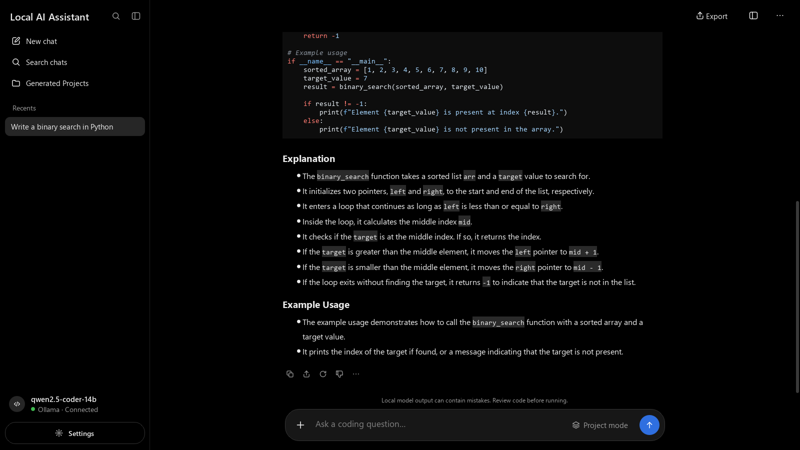
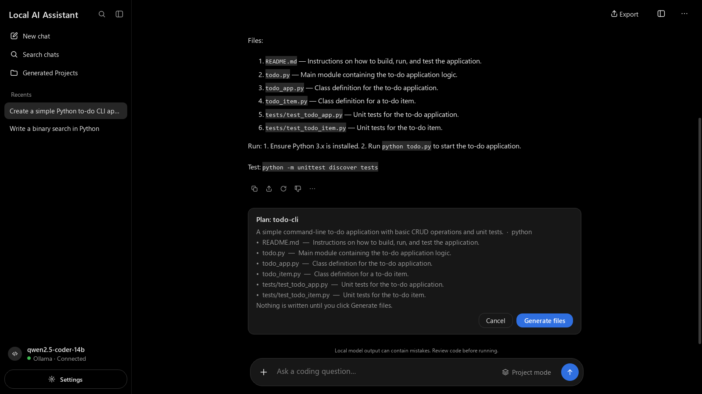
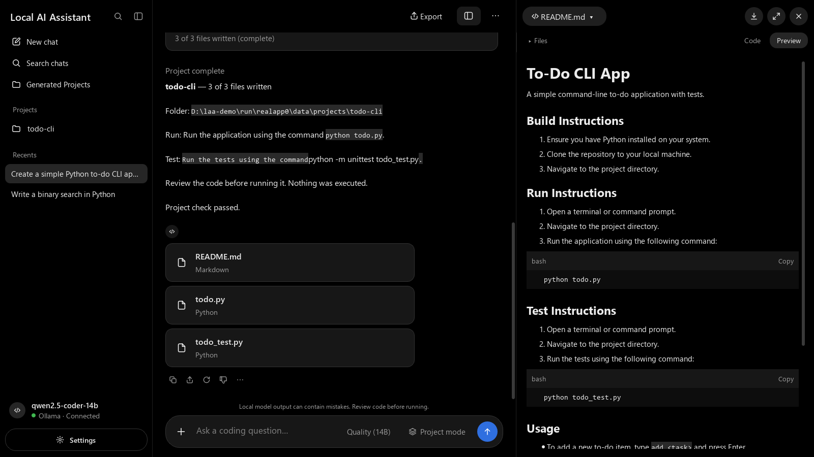
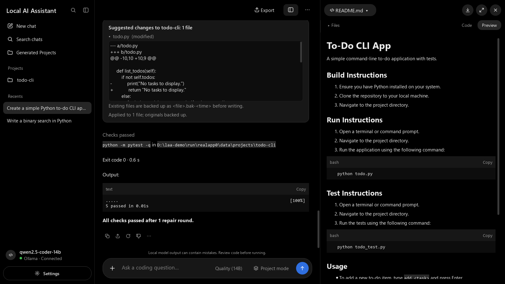

# Local AI Assistant

A native Windows 11 desktop coding assistant (Python + PySide6) that runs **fully offline**. Every
answer comes from a model on your own computer through [Ollama](https://ollama.com) — the exact model
`qwen2.5-coder-14b:latest`. No cloud APIs, no telemetry, no model fallback.

Version **1.0.0** · MIT License · see [CHANGELOG.md](CHANGELOG.md)



| Project mode: plan first | Generated files in the preview | Tests and repair loop |
|---|---|---|
|  |  |  |

Screenshots are captured by the REAL end-to-end test (`tests/test_integration_app.py`) with the local model.

## Features

- **Coding chat** with streaming answers, Stop, Regenerate, syntax-highlighted code blocks with Copy,
  and a coding-only system prompt (off-topic requests are politely redirected).
- **Persistent history** in SQLite: chats, messages, feedback and projects survive restarts.
- **Project mode**: the model plans the files first (Plan card); nothing is written until you click
  **Generate files**. Files appear as cards and in the preview panel (code view + offline HTML/Markdown preview).
- **Edits and repair**: in a project chat, suggested changes are shown as a diff and written only after
  **Apply changes** (originals backed up). **Run project tests** runs allowlisted commands after your approval;
  failures go back to the model for at most 3 repair rounds.
- **Safe by design**: path validation (no traversal, drive/UNC paths, reserved names or symlink escapes),
  an allowlisted command runner (`shell=False`, project folder only, timeouts), and model text is never executed.
- **Export** to a folder or a verified ZIP, leaving out caches, virtual environments, backups and secrets.
- **Offline**: the Ollama URL must be loopback; the HTML preview blocks remote requests.

## Requirements

- Windows 11 (64-bit), 16 GB RAM or more, ~12 GB free disk
- [Ollama](https://ollama.com) running on `http://localhost:11434`
- The model `qwen2.5-coder-14b:latest` (created from `qwen2.5-coder:14b` with `ollama/Modelfile`)
- From source: Python 3.12 (3.10–3.12 supported)
- Optional: JDK 21 (Java projects), Git

## Install

**Packaged app** — see [docs/INSTALL.md](docs/INSTALL.md) (prerequisites, model setup, first run,
troubleshooting, antivirus and SmartScreen notes).

**From source:**

```powershell
ollama pull qwen2.5-coder:14b
ollama create qwen2.5-coder-14b -f .\ollama\Modelfile
py -V:3.12 -m venv venv
.\venv\Scripts\Activate.ps1
python -m pip install -r requirements-dev.txt     # or requirements.txt to only run the app
```

## Run

```powershell
python main.py --check     # environment summary (version, Ollama, model, database)
python main.py             # open the app
python main.py --version
python main.py --demo      # canned answers, no model needed
```

Build the Windows app (onedir, ~322 MB):

```powershell
.\venv\Scripts\pyinstaller packaging\LocalAIAssistant.spec --noconfirm
dist\LocalAIAssistant\LocalAIAssistant.exe --check
```

## Tests

```powershell
python -m pytest -v                    # unit + GUI tests (offscreen, model mocked)
python -m pytest -v -m integration     # REAL model tests, incl. the end-to-end app test (slow)
python -m pytest --offline-guard       # whole suite with non-loopback sockets blocked
python -m pytest --cov=app             # coverage
.\venv\Scripts\python.exe scripts\run_java_sample.py      # REAL Java sample: generate, compile, test
.\venv\Scripts\python.exe scripts\benchmark.py --label x  # REAL speed benchmark
```

Results, with MOCK and REAL clearly separated: [docs/TEST_REPORT.md](docs/TEST_REPORT.md).

## Project structure

```
main.py                    entry point (--check, --version, --demo, --screenshot)
app/
  config.py, errors.py, logging_setup.py, __version__.py
  backend/     ollama_client.py, chat_service.py, chat_store.py, memory_store.py, task_classifier.py, status.py
  agent/       project_generator.py, coding_agent.py, tool_runner.py
  storage/     database.py (migrations), chat_repository.py
  validation/  path_validator.py, project_validator.py
  export/      project_exporter.py
  prompts/     coding_system_prompt.txt
  ui/          main_window.py, chat_view.py, message_widgets.py, agent_widgets.py, preview_panel.py,
               sidebar.py, composer.py, dialogs.py, workers.py, offline_web.py, theme.py, icons/
ollama/Modelfile           the exact model settings
packaging/                 PyInstaller spec
scripts/                   REAL benchmark, Java sample, Ollama restart helper
docs/                      INSTALL, OFFLINE, PERFORMANCE, TEST_REPORT, samples, screenshots
tests/                     unit, GUI, offline and integration tests
```

## Configuration

Settings come from `app/config.py`, overridable with environment variables (`LAA_` prefix):

| Variable | Default |
|---|---|
| `LAA_OLLAMA_URL` | `http://localhost:11434` (loopback hosts only) |
| `LAA_DATA_DIR` | `%LOCALAPPDATA%\LocalAIAssistant` (database, logs, projects) |
| `LAA_EXPORT_DIR` | your Desktop (also in Settings) |
| `LAA_TEMPERATURE` / `LAA_TOP_P` / `LAA_NUM_CTX` | `0.2` / `0.8` / `8192` |
| `LAA_REQUEST_TIMEOUT_S` / `LAA_CONNECT_TIMEOUT_S` | `120` / `5` |
| `LAA_STREAM_READ_TIMEOUT_S` | `300` (max gap between streamed chunks, incl. model load) |
| `LAA_COMMAND_TIMEOUT_S` | `60` (approved commands; also in Settings) |
| `LAA_KEEP_ALIVE` | `10m` |
| `LAA_HEALTH_INTERVAL_S` | `10` |
| `LAA_LOG_LEVEL` | `INFO` |
| `LAA_MODEL_NAME` | `qwen2.5-coder-14b:latest` (overriding logs a warning; never changed automatically) |

## Performance note

On the development laptop (Ryzen 5 7235HS, RTX 3050 with 4 GB VRAM) the 14B model runs mostly on the CPU
at about **3–4 tokens per second**: a short answer takes about a minute and a 4-file project about 9–15
minutes. Context-size and flash-attention trials did not help reliably, so the defaults are kept.
Details: [docs/PERFORMANCE.md](docs/PERFORMANCE.md).

## Known limitations

- Slow on CPU-heavy machines (see above); close heavy apps while generating.
- The Wi-Fi-off manual checklist in [docs/OFFLINE.md](docs/OFFLINE.md) has to be run by you.
- The packaged app is not code-signed (SmartScreen warning) and is ~322 MB because of QtWebEngine.
- `pytest --offline-guard` can occasionally crash at process exit after all tests passed (Qt shutdown).
- Python projects run from the packaged app use the `python` on your PATH.
- Light theme is a placeholder.

Full list: [docs/TEST_REPORT.md](docs/TEST_REPORT.md).

## License

MIT © 2026 Sivasubramaniyan T — see [LICENSE](LICENSE).
